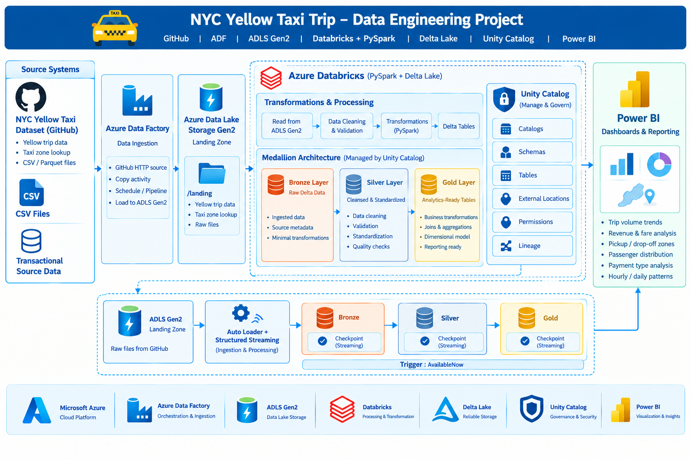

# 🚕 NYC Yellow Taxi Trip Data Engineering ETL Project | 🐙 GitHub | ☁️ Azure Data Factory | 🗄️ ADLS Gen2 | ⚡ Databricks & PySpark | 🧱 Delta Lake | Unity Catalog | 📊 Power BI

## Overview

This project implements an end-to-end Azure Data Engineering pipeline to ingest, process, transform, and visualize NYC Yellow Taxi trip data using Azure cloud services and the Medallion Architecture.

The pipeline uses Azure Data Factory to transfer source data from GitHub to Azure Data Lake Storage Gen2 (ADLS Gen2). Azure Databricks processes the data using PySpark and Delta Lake, while Unity Catalog manages data organization and governance. The transformed Gold-layer datasets are used to build interactive Power BI dashboards for analytical reporting.

## Technology Stack

- Microsoft Azure
- Azure Data Factory (ADF)
- Azure Data Lake Storage Gen2 (ADLS Gen2)
- Azure Databricks
- PySpark
- Delta Lake
- Unity Catalog
- Power BI
- GitHub
- Medallion Architecture

---

## Architecture Flow

```text
        NYC Yellow Taxi Dataset
               GitHub
                 |
                 v
       Azure Data Factory
         Data Ingestion
                 |
                 v
        Azure Data Lake
          Storage Gen2
           Landing Zone
                 |
                 v
        Azure Databricks
         PySpark + Delta
                 |
                 v
          Bronze Layer
          Raw Delta Data
                 |
                 v
          Silver Layer
       Cleansed & Standardized
                 |
                 v
           Gold Layer
       Analytics-Ready Tables
                 |
                 v
              Power BI
       Dashboards & Reporting
```

# 1. Data Source

The project uses the NYC Yellow Taxi trip dataset, which contains records of taxi trips in New York City.

The dataset includes trip details, pickup and drop-off timestamps, passenger counts, trip distances, fare information, payment details, and pickup/drop-off location identifiers.

Additional lookup data, such as taxi zone information, is used to provide geographic context for trip analysis.

**Source data includes:**

- Yellow taxi trip records
- Taxi zone lookup data

The source files are maintained in GitHub and transferred to Azure storage through Azure Data Factory.

# 2. Azure Data Factory — Data Ingestion

Azure Data Factory is used to ingest source files from GitHub into ADLS Gen2.

### Responsibilities

- Configure the GitHub HTTP source connection.
- Configure the ADLS Gen2 destination.
- Copy source dataset files into the landing zone.
- Organize incoming files for downstream processing.
- Separate ingestion from transformation logic.

### Data Flow

```text
GitHub Repository
        |
        v
Azure Data Factory
        |
        v
ADLS Gen2 Landing Zone
```

This ingestion layer establishes the foundation for the downstream data engineering pipeline.

# 3. Azure Data Lake Storage Gen2

ADLS Gen2 serves as the central storage layer for the pipeline.

The landing zone stores the ingested source files before they are processed by Databricks.

### Example Storage Structure

```text
ADLS Gen2
│
├── Landing / Raw Data
│   ├── yellow_tripdata_2019-01.parquet
│   ├── yellow_tripdata_2019-02.parquet
│   └── taxi_zone_lookup.parquet
│
├── Unity Catalog
```
ADLS Gen2 provides scalable storage for the source data and supports the different stages of the Medallion Architecture.

# 4. Azure Databricks and Unity Catalog

Azure Databricks is the primary data processing platform used to transform the ingested datasets.

PySpark is used for distributed data processing, while Delta Lake provides reliable storage for the Bronze, Silver, and Gold tables.

Unity Catalog is used to organize and govern the data assets.

### Responsibilities

- Read source files from ADLS Gen2.
- Create and manage Unity Catalog objects.
- Process data using PySpark DataFrames.
- Store transformed datasets as Delta tables.
- Organize tables into the appropriate schemas.
- Manage access to data assets through Unity Catalog permissions.

### Processing Flow

```text
ADLS Gen2
    |
    v
Databricks
    |
    v
Unity Catalog
    |
    v
Bronze → Silver → Gold
```

# 5. Bronze Layer — Raw Data Ingestion

The Bronze layer stores the source datasets as Delta tables.

This layer preserves the ingested data in a structured table format for downstream processing.

### Responsibilities

- Read raw trip and taxi zone files from ADLS Gen2.
- Load source data into Databricks.
- Convert and store data as Delta tables.
- Preserve source-level information.
- Maintain a foundation for repeatable downstream transformations.

### Example Tables

- `brz_yellow_tripdata`
- `brz_taxizone_lookup`

### Data Flow

```text
ADLS Gen2 Source Files
          |
          v
    PySpark Ingestion
          |
          v
     Bronze Delta Tables
```

# 6. Silver Layer — Data Cleaning and Transformation

The Silver layer contains cleansed and standardized datasets derived from the Bronze tables.

PySpark transformations are applied to improve data quality and prepare the datasets for analytical processing.

### Responsibilities

- Standardize data types.
- Handle null and invalid values.
- Clean inconsistent categorical values.
- Apply appropriate data quality rules.
- Refine trip and taxi zone datasets.
- Prepare trusted data for Gold-layer transformations.

### Example Transformations

- Cast monetary and numerical fields to appropriate data types.
- Handle missing values in selected columns.
- Standardize taxi zone attributes.
- Validate trip distance, fare, and passenger-related fields.
- Prepare consistent datasets for analytical queries.

### Data Flow

```text
Bronze Tables
      |
      v
Data Cleaning
      |
      v
Type Standardization
      |
      v
Data Quality Validation
      |
      v
Silver Delta Tables
```

The Silver layer provides refined datasets that can be reused for multiple analytical requirements.

# 7. Gold Layer — Analytics-Ready Data

The Gold layer contains business-oriented datasets designed for reporting and analytical consumption.

The cleaned Silver datasets are transformed into consolidated analytical tables using PySpark and Spark SQL where appropriate.

### Responsibilities

- Combine relevant Silver datasets.
- Apply analytical transformations.
- Prepare consolidated trip datasets.
- Enrich trip records with taxi zone information where applicable.
- Create useful attributes and metrics for reporting.
- Store analytics-ready data as Delta tables.

### Example Gold Dataset

`gld_taxi_trips`

The consolidated dataset can include relevant trip attributes such as:

- Pickup and drop-off timestamps
- Passenger count
- Trip distance
- Fare amount
- Total amount
- Payment type
- Pickup and drop-off location identifiers
- Taxi zone descriptions, where joined

### Analytical Use Cases

- Total trips and trip volume trends
- Revenue and fare analysis
- Average trip distance
- Passenger distribution
- Pickup and drop-off zone analysis
- Hourly, daily, and monthly trip patterns
- Payment type distribution

### Data Flow

```text
Silver Trip Data
        |
        +------+
        |      |
        v      v
  Trip Cleaning   Taxi Zone Data
        |      |
        +---+--+
            |
            v
      Business Joins
            |
            v
    Gold Delta Tables
```

# 8. Unity Catalog — Data Governance

Unity Catalog is used to organize, access, and govern data assets in Azure Databricks.

The project uses Unity Catalog to manage the catalog, schemas, tables, storage access, and permissions required by the pipeline.

### Example Logical Structure

```text
Unity Catalog
│
└── nyc_taxitrip
    │
    ├── bronze
    │   ├── brz_yellow_tripdata
    │   └── brz_taxizone_lookup
    │
    ├── silver
    │   ├── slv_yellow_tripdata
    │   └── slv_taxizone_lookup
    │
    └── gold
        └── gld_taxi_trips
```

*The structure above is illustrative. Update the catalog, schema, and table names to match the actual objects created in your notebooks.*

### Unity Catalog Capabilities Used

- Catalog and schema organization
- Managed or external table management, as configured
- External locations and storage credentials
- Access control and permissions
- Centralized data asset management

# 9. Power BI — Data Visualization

Power BI is used to visualize the transformed data and present analytical insights through interactive dashboards.

The Gold-layer datasets provide the reporting-ready data used for visualizations.

### Dashboard Objectives

- Analyze taxi trip volume over time.
- Identify peak pickup hours and travel periods.
- Compare trip distances and fare amounts.
- Analyze revenue and total trip charges.
- Explore pickup and drop-off zones.
- Examine passenger and payment type distributions.

### Example Visualizations

- KPI cards for total trips, total revenue, and average fare
- Line charts for daily or monthly trip trends
- Bar charts for popular pickup and drop-off zones
- Column charts for hourly trip distribution
- Donut charts for payment type distribution
- Geographic visualizations for taxi zone analysis

### Reporting Flow

```text
Gold Delta Tables
        |
        v
Power BI Data Connection
        |
        v
Data Modeling
        |
        v
Interactive Dashboards
```

*The Power BI connection method depends on the configuration used in the project, such as a supported Databricks connector or an intermediate export.*

# 10. End-to-End Pipeline

The complete pipeline follows these stages:

```text
GitHub
   |
   v
Azure Data Factory
   |
   v
ADLS Gen2 Landing Zone
   |
   v
Azure Databricks
   |
   v
Bronze Layer
Raw Delta Tables
   |
   v
Silver Layer
Cleansed & Standardized Tables
   |
   v
Gold Layer
Analytics-Ready Tables
   |
   v
Power BI
Dashboards & Business Insights
```

Each stage has a distinct responsibility, separating ingestion, transformation, governance, and reporting.

# 11. Data Layer Responsibilities

| Layer | Purpose | Main Operations |
|---|---|---|
| GitHub | Source file repository | Dataset versioning and storage |
| ADF | Data ingestion | Copy files from GitHub to ADLS Gen2 |
| Landing | Initial data storage | Store incoming source files |
| Bronze | Raw processed data | Delta conversion and ingestion |
| Silver | Trusted data | Cleaning, validation, standardization |
| Gold | Analytical data | Joins, consolidation, analytical attributes |
| Unity Catalog | Governance | Organize tables, schemas, and permissions |
| Power BI | Reporting | Data modeling and visualization |

# 12. Key Design Principles

### Separation of Responsibilities
Azure Data Factory handles ingestion, Databricks handles transformation, Unity Catalog manages data organization and governance, and Power BI supports analytics.

### Medallion Architecture
Data is progressively refined from source files to Bronze, Silver, and Gold layers.

### Data Quality
Silver transformations address data types, missing values, inconsistent attributes, and other applicable validation rules.

### Reusability
Silver datasets can support multiple Gold analytical tables and reporting requirements.

### Governance
Unity Catalog provides centralized management of data assets and access permissions.

### Analytics Readiness
Gold datasets are structured to simplify reporting and analytical queries.

# 13. Repository Structure

The project is organized as follows:

```text
nyc-taxi-lakehouse-azure-databricks/
│
├── Medallion_Processing/
│   ├── Bronze-to-Silver.ipynb
│   ├── Raw-to-Bronze.ipynb
│   └── Silver-to-Gold.ipynb
│
├── NYC Taxi-Trip Data/
│
├── Setup/
│   ├── Catalog Creation and Schema ...
│   └── Raw Schema Creation and External ...
│
└── README.md
```

# 14. Getting Started

## Prerequisites

- Azure subscription
- Azure Data Factory
- ADLS Gen2 storage account
- Azure Databricks workspace with Unity Catalog enabled
- Appropriate Azure Storage and Unity Catalog permissions
- GitHub repository containing the source datasets
- Power BI Desktop

## Execution Workflow

1. **Configure source data:** Make the NYC Yellow Taxi and taxi zone datasets available in the GitHub repository.
2. **Configure Azure Data Factory:** Set up the source and destination connections and copy the required files to ADLS Gen2.
3. **Configure Unity Catalog:** Create the required catalog, schemas, storage credentials, external locations, and volumes as applicable.
4. **Execute Bronze notebooks:** Read source files from the landing zone and create Bronze Delta tables.
5. **Execute Silver notebooks:** Clean, validate, and standardize the Bronze datasets.
6. **Execute Gold notebooks:** Combine the refined datasets and create the analytical tables.
7. **Connect Power BI:** Connect to the Gold datasets using the configured data connection.
8. **Build dashboards:** Create interactive reports to analyze trip volume, fares, revenue, and taxi zone trends.

# 15. Project Outcome

This project demonstrates an end-to-end cloud data engineering workflow using Azure services and modern lakehouse technologies.

It showcases practical implementation of:

- Cloud-based data ingestion using Azure Data Factory
- Data lake storage using ADLS Gen2
- Distributed data transformation using PySpark
- Medallion Architecture using Delta Lake
- Data governance using Unity Catalog
- Analytical dataset preparation using Gold-layer transformations
- Business intelligence reporting using Power BI

The final outcome is a scalable and organized data pipeline that transforms NYC Yellow Taxi trip data into analytics-ready datasets and interactive visual reports.

# **Medallion Architecture Diagram:**

  
